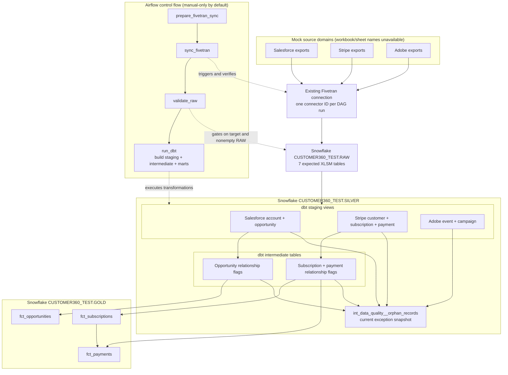

# Customer360 current architecture review

**Review date:** 2026-11-13

**Scope:** Current repository working tree; code and configuration review only.
**Evidence rule:** “Implemented” means present in the checked-out source/configuration, not proven deployed or live. “Configured” means a runtime contract or expected value exists but was not verified against the external service. Earlier audit reports and validation notes were not used as proof of current behavior.

No pipeline, dbt command, Snowflake query, Fivetran API request, SMTP delivery, or integration was run for this review. Secret files, private-key contents, `.env`, and the mounted dbt profile were not read.

## A. Manager-facing architecture summary

The current code implements a **source-to-fact pipeline, not a fully integrated Customer 360 product**. The intended development path is mock workbook exports through existing Fivetran connection(s) into `CUSTOMER360_TEST.RAW`; seven dbt staging views are built in `SILVER`, followed by three relationship-checking fact models and a current-state exception table, then three Gold fact tables. The current model graph does not implement a customer dimension, a unified customer-360 entity, cross-system identity resolution, or aggregated business metrics.

Airflow's `customer360_pipeline` DAG is configured as the orchestrator: check runtime settings, force and await a Fivetran sync, recheck completion, verify the expected nonempty RAW tables, then run one dbt build for staging, intermediate, and marts. The code has fail-closed freshness-of-sync and target guards, but the review did not execute those checks against live services. The repository configures one Fivetran connector ID per run; whether that one connector populates all seven tables is an external deployment fact.

The declared data layers are `RAW` → `SILVER` → `GOLD`. `RAW` is the Snowflake landing layer. There is **no separate Bronze layer** in the configured dbt project. “dbt staging” means the SQL models/views in `SILVER`; it is not a Fivetran internal staging schema. No Fivetran-internal schema name or connector configuration is stored in this repository.

The report treats the existing working-tree changes as the current source, not as evidence of a deployed revision. Current code/configuration evidence is listed by repository-relative path and line number below. Runtime success, actual table contents, freshness, connector setup, effective Snowflake grants, and alert delivery remain unverified.

## B. Node inventory

Status labels: **Implemented (code)** = defined in this checkout; **Configured (live unverified)** = code expects or configures it but no external state was checked; **Absent** = no current implementation found.

| node | purpose | system/schema | view/table/service | implementation status |
|---|---|---|---|---|
| Salesforce mock workbook export | Upstream source domain; workbook filename and worksheet name are not recorded in the repository. | Google Drive / Fivetran source (as described in Airflow docs) | External file | Configured concept; exact file/sheet unverified. |
| Stripe mock workbook exports | Upstream source domain; workbook filenames and worksheet names are not recorded. | Google Drive / Fivetran source | External files | Configured concept; exact files/sheets unverified. |
| Adobe mock workbook exports | Upstream source domain; workbook filenames and worksheet names are not recorded. | Google Drive / Fivetran source | External files | Configured concept; exact files/sheets unverified. |
| Fivetran connection | Triggered by Airflow using `customer360_fivetran`; connector ID comes from `CUSTOMER360_FIVETRAN_CONNECTOR_ID`. The current DAG constructs a one-item connector list. | Fivetran API / Airflow | External connector | Code integration implemented; actual ID, source setup, and coverage unverified. |
| Fivetran destination | Destination ID comes from `CUSTOMER360_FIVETRAN_DESTINATION_ID`; runtime guard expects Snowflake, `CUSTOMER360_TEST`, and `RAW`. | Fivetran / Snowflake | External destination | Target contract implemented; live configuration unverified. |
| Salesforce account landing | Physical identifier expected by dbt and Airflow. | `CUSTOMER360_TEST.RAW` | `MOCK_SALESFORCE_XLSM_ACCOUNTS` table | Configured/expected; not queried live. |
| Salesforce opportunity landing | Physical identifier expected by dbt and Airflow. | `CUSTOMER360_TEST.RAW` | `MOCK_SALESFORCE_XLSM_OPPORTUNITIES` table | Configured/expected; not queried live. |
| Adobe event landing | Physical identifier expected by dbt and Airflow. | `CUSTOMER360_TEST.RAW` | `MOCK_ADOBE_XLSM_EVENTS` table | Configured/expected; not queried live. |
| Adobe campaign landing | Physical identifier expected by dbt and Airflow. | `CUSTOMER360_TEST.RAW` | `MOCK_ADOBE_XLSM_CAMPAIGNS` table | Configured/expected; not queried live. |
| Stripe customer landing | Physical identifier expected by dbt and Airflow. | `CUSTOMER360_TEST.RAW` | `MOCK_STRIPE_XLSM_CUSTOMERS` table | Configured/expected; not queried live. |
| Stripe subscription landing | Physical identifier expected by dbt and Airflow. | `CUSTOMER360_TEST.RAW` | `MOCK_STRIPE_XLSM_SUBSCRIPTIONS` table | Configured/expected; not queried live. |
| Stripe payment landing | Physical identifier expected by dbt and Airflow. | `CUSTOMER360_TEST.RAW` | `MOCK_STRIPE_XLSM_PAYMENTS` table | Configured/expected; not queried live. |
| `stg_salesforce__accounts` | Clean, cast and deterministically deduplicate accounts by source account ID. | `CUSTOMER360_TEST.SILVER` | View | Implemented in dbt; live creation unverified. |
| `stg_salesforce__opportunities` | Clean, cast and deterministically deduplicate opportunities by source opportunity ID. | `CUSTOMER360_TEST.SILVER` | View | Implemented in dbt; live creation unverified. |
| `stg_stripe__customers` | Clean and deduplicate customers by customer ID; email is not an identity key. | `CUSTOMER360_TEST.SILVER` | View | Implemented in dbt; live creation unverified. |
| `stg_stripe__subscriptions` | Clean and deduplicate subscriptions by subscription ID. | `CUSTOMER360_TEST.SILVER` | View | Implemented in dbt; live creation unverified. |
| `stg_stripe__payments` | Clean and deduplicate payments by payment ID; retain optional subscription references and orphan facts. | `CUSTOMER360_TEST.SILVER` | View | Implemented in dbt; live creation unverified. |
| `stg_adobe__events` | Clean and deduplicate events by event ID. | `CUSTOMER360_TEST.SILVER` | View | Implemented in dbt; live creation unverified. |
| `stg_adobe__campaigns` | Clean and deduplicate campaigns by campaign ID. | `CUSTOMER360_TEST.SILVER` | View | Implemented in dbt; live creation unverified. |
| `int_salesforce__opportunities` | Preserve staged opportunities and flag missing account parents. | `CUSTOMER360_TEST.SILVER` | Table | Implemented in dbt; live creation unverified. |
| `int_stripe__subscriptions` | Preserve staged subscriptions and flag missing customers. | `CUSTOMER360_TEST.SILVER` | Table | Implemented in dbt; live creation unverified. |
| `int_stripe__payments` | Preserve staged payments and flag missing, orphaned, or mismatched customer/subscription relationships. | `CUSTOMER360_TEST.SILVER` | Table | Implemented in dbt; live creation unverified. |
| `int_data_quality__orphan_records` | Rebuild current exception rows from intermediate flags and selected staging date fields. | `CUSTOMER360_TEST.SILVER` | Table | Implemented in dbt; live creation unverified. |
| `fct_opportunities` | One trusted row per eligible opportunity; source has no currency field. | `CUSTOMER360_TEST.GOLD` | Table | Implemented in dbt; live creation unverified. |
| `fct_subscriptions` | One trusted current-state row per eligible subscription; not a history or recurring-revenue model. | `CUSTOMER360_TEST.GOLD` | Table | Implemented in dbt; live creation unverified. |
| `fct_payments` | One trusted row per eligible payment; amount retains source currency and status, including failed. | `CUSTOMER360_TEST.GOLD` | Table | Implemented in dbt; live creation unverified. |
| Airflow DAG | Orchestrate sync, RAW validation, and dbt build. | Airflow | `customer360_pipeline` | Implemented/configured; no run status asserted. |
| PostgreSQL metadata database | Airflow metadata persistence. | Docker Compose | `postgres` service + named volume | Configured; runtime health not checked. |
| Airflow API server, scheduler, DAG processor, triggerer, init | Local Airflow web/API, orchestration, parsing, deferrable sync support, and metadata migration. | Docker Compose | Services | Configured; container state not checked. |
| `customer360_smtp` | Failure notification transport expected by callback. | Airflow connection | SMTP provider connection | Configured by reference; delivery not tested. |
| BI dashboard / semantic layer | No dashboard, BI connection, semantic model, or consumer-facing view is defined in current application files. | — | — | Absent. |
| Cortex Analyst / Cortex Agents | No Cortex semantic model, Analyst, Agent, or invocation is defined in current application files. | — | — | Absent; repository purpose text is not implementation evidence. |
| Keycloak | No Keycloak service, provider, or application integration is defined. | — | — | Absent. |
| Azure Key Vault | No vault client, managed/workload identity integration, secret backend, or deployment is configured. | — | — | Absent; current local secrets are mounts, not a vault. |

**Evidence for inventory:** `dbt/models/staging/_sources.yml:8-38`; `airflow/dags/customer360_pipeline.py:28-51, 117-121, 766-856`; `dbt/dbt_project.yml:32-42`; `dbt/macros/generate_schema_name.sql:1-13`; the individual model SQL paths listed in section C; `docker-compose.yaml:1-191`; `docker/airflow.Dockerfile:1-35`.

### Implemented dbt lineage

`staging` models materialize as views; `intermediate` and `marts` materialize as tables. The configured local `dev` profile routes mart models to the shared `GOLD` schema only when target database is `CUSTOMER360_TEST` and target schema is `SILVER`. The Airflow manifest guard independently requires all non-mart models to be in `CUSTOMER360_TEST.SILVER`, marts in `CUSTOMER360_TEST.GOLD`, and sources in `CUSTOMER360_TEST.RAW`.

| source → staging | intermediate | Gold / current outcome |
|---|---|---|
| `raw.mock_salesforce_accounts` → `stg_salesforce__accounts` | Parent lookup for `int_salesforce__opportunities`; also inspected for missing `updated_at` exceptions. | No account dimension or account mart. |
| `raw.mock_salesforce_opportunities` → `stg_salesforce__opportunities` | `int_salesforce__opportunities` | `fct_opportunities` |
| `raw.mock_stripe_customers` → `stg_stripe__customers` | Parent lookup for `int_stripe__subscriptions` and `int_stripe__payments`; also inspected for missing `created_at` exceptions. | No customer dimension or customer-360 model. |
| `raw.mock_stripe_subscriptions` → `stg_stripe__subscriptions` | `int_stripe__subscriptions`; also parent input to `int_stripe__payments`. | `fct_subscriptions`; referenced by `fct_payments`. |
| `raw.mock_stripe_payments` → `stg_stripe__payments` | `int_stripe__payments` | `fct_payments` |
| `raw.mock_adobe_events` → `stg_adobe__events` | No event intermediate model; also inspected for missing `event_timestamp` exceptions. | No event mart or marketing metric. |
| `raw.mock_adobe_campaigns` → `stg_adobe__campaigns` | No campaign intermediate model. | No campaign dimension or mart. |
| The above three relationship-aware intermediates plus staging Adobe events, Stripe customers, and Salesforce accounts | `int_data_quality__orphan_records` | Silver exception snapshot only; no Gold consumer is implemented. |

Dependencies use dbt `source()`/`ref()` rather than hardcoded transformation lineage. Evidence: source mappings at `dbt/models/staging/_sources.yml:14-38`; staging source references at `dbt/models/staging/stg_salesforce__accounts.sql:14`, `dbt/models/staging/stg_salesforce__opportunities.sql:18`, `dbt/models/staging/stg_stripe__customers.sql:11`, `dbt/models/staging/stg_stripe__subscriptions.sql:14`, `dbt/models/staging/stg_stripe__payments.sql:20`, `dbt/models/staging/stg_adobe__events.sql:16`, and `dbt/models/staging/stg_adobe__campaigns.sql:15`; intermediate references at `dbt/models/intermediate/int_salesforce__opportunities.sql:3-17`, `dbt/models/intermediate/int_stripe__subscriptions.sql:1-18`, `dbt/models/intermediate/int_stripe__payments.sql:1-48`, and `dbt/models/intermediate/int_data_quality__orphan_records.sql:1-99`; marts at `dbt/models/marts/fct_opportunities.sql:1-10`, `dbt/models/marts/fct_subscriptions.sql:1-10`, and `dbt/models/marts/fct_payments.sql:1-20`.

**Gold scope and missing requested components:** the three facts are the only implemented Gold models. There are no `dim_*` models, no `customer_360` model, no unified customer key or cross-source identity matching, and no aggregate KPI/revenue metric. Stripe payments retain currency and status; the model documentation explicitly says this is not a revenue metric. Salesforce opportunity amounts have no currency code in the source model. No Adobe event/campaign business mart exists. Evidence: only three SQL files under `dbt/models/marts/`; `dbt/models/marts/schema.yml:3-145`; `dbt/models/intermediate/README.md:1-5, 65-80`.

## C. Connection inventory

| from | to | relationship type | trigger/condition | code evidence |
|---|---|---|---|---|
| Mock workbook exports (documented generically as Google Drive sources) | Existing Fivetran connection(s) | Ingestion; Fivetran owns source access | Connector configuration is external. Airflow has one configured connector ID per run and does not change the connector's existing manual/automatic schedule. Workbook filenames and worksheet names are not recorded. | `airflow/README.md:4-5, 21-30, 45-58`; `airflow/dags/customer360_pipeline.py:115-121, 281-315, 849-856` |
| Fivetran connector | Fivetran Snowflake destination | API metadata check + force sync + asynchronous completion wait | Pre-trigger checks require connector ID/group ID match, Snowflake destination, expected TEST database and RAW schema, connected setup, unpaused connector, and valid existing schedule type. Completion must be newer than the stored pre-sync watermark, idle (`scheduled`), and not superseded by a newer failure. | `airflow/dags/customer360_pipeline.py:252-278, 281-369`; provider version documented at `airflow/README.md:19-23` |
| Fivetran Snowflake destination | Seven expected `CUSTOMER360_TEST.RAW` tables | Source-aligned landing | Fivetran sync must complete and pass the asynchronous status recheck; RAW validation then requires each allowlisted table to exist and contain at least one row. No freshness threshold or count reconciliation is implemented in this gate. | `dbt/models/staging/_sources.yml:8-38`; `airflow/dags/customer360_pipeline.py:32-40, 464-503`; `dbt/models/staging/README.md:26-43` |
| `RAW` source tables | Seven dbt staging models | dbt source → view | Included in `dbt build --select staging intermediate marts --threads 1`; staging models read with `source('raw', ...)`. | `dbt/models/staging/_sources.yml:14-38`; staging SQL references listed in section B; `airflow/dags/customer360_pipeline.py:697-707` |
| Salesforce staging views | `int_salesforce__opportunities` | Exact-ID parent match; orphan flag, no fact drop | Account IDs are matched as source IDs, not emails; intermediate output preserves the staged opportunity rows. | `dbt/models/intermediate/int_salesforce__opportunities.sql:1-19` |
| Stripe staging views | `int_stripe__subscriptions` and `int_stripe__payments` | Exact-ID parent / subscription match; relationship flags | Customer and subscription relationships are checked by source IDs; duplicate subscription IDs are guarded by model tests. | `dbt/models/intermediate/int_stripe__subscriptions.sql:1-18`; `dbt/models/intermediate/int_stripe__payments.sql:1-48` |
| Salesforce/Stripe intermediate facts and selected staging date columns | `int_data_quality__orphan_records` | Exception reporting; current-state snapshot | Rebuilt with the dbt build; rows are produced per applicable exception reason. It is not an append-only history. | `dbt/models/intermediate/int_data_quality__orphan_records.sql:1-111`; `dbt/models/intermediate/schema.yml:221-280` |
| Relationship-aware Silver facts | Three Gold fact tables | Eligibility filtering and fact publication | `fct_opportunities` and `fct_subscriptions` exclude `is_orphan`; `fct_payments` excludes orphan flags and requires a referenced subscription to resolve to the same customer in Gold. | `dbt/models/marts/fct_opportunities.sql:1-10`, `dbt/models/marts/fct_subscriptions.sql:1-10`, `dbt/models/marts/fct_payments.sql:1-20` |
| Airflow `prepare_fivetran_sync` → `sync_fivetran` → `validate_raw` → `run_dbt` | Pipeline control | Task dependencies; upstream must succeed | Prepare checks recipients/config; mapped sync must report verified completion; RAW validation must return all seven nonempty tables; dbt then runs. | `airflow/dags/customer360_pipeline.py:766-856`; exact dependency assertions in `airflow/tests/test_customer360_pipeline.py:91-127` |
| `run_dbt` | dbt project / Snowflake | Transform and test execution | Parses and validates the manifest/profile, then builds all three model layers in one invocation. | `airflow/dags/customer360_pipeline.py:647-720`; `airflow/README.md:405-415` |
| Airflow failed task | SMTP connection | Failure notification | Callback sends DAG/task identifiers only, using `customer360_smtp` and configured `CUSTOMER360_ALERT_EMAILS`; missing recipients block preflight, and mail delivery is not verified. | `airflow/dags/customer360_pipeline.py:73-110, 789-796`; `docker-compose.yaml:36`; `airflow/README.md:417-428` |
| Airflow services | PostgreSQL metadata database | Airflow metadata persistence | Compose dependency and health checks govern service startup. | `docker-compose.yaml:97-127, 187-202` |
| Gold facts | BI, semantic layer, Cortex, or application consumer | No current repository-defined edge | No BI connection, consumer model, or semantic/Agent integration was found in the current implementation inventory. | No current implementation files/configuration; project-purpose statements in `AGENTS.md` are not implementation evidence. |

### Ingestion and physical RAW tables

The current dbt source contract maps seven logical `raw.*` names to the XLSM identifiers listed in the node inventory. Airflow's `RAW_TABLES` allowlist matches the same seven. The source contract documents `_line` and `_fivetran_synced` as expected metadata and states `_fivetran_deleted` is not part of the current contract (`dbt/models/staging/_sources.yml:5-10`).

**Workbook names and sheet names:** no `.xls`, `.xlsx`, or `.xlsm` workbook file, source filename, or sheet mapping is present in the current repository inventory. The current implementation names only source domains and expected Snowflake table identifiers. Therefore, actual workbook filenames and worksheet names cannot be supplied from repository evidence. The Fivetran connection/destination IDs and connector-to-workbook mapping are runtime/external configuration, not checked-in configuration.

**Legacy table use:** current source declarations explicitly map to the seven `_XLSM_` identifiers. The staging docs say legacy non-XLSM tables are not queried and there is no union/fallback (`dbt/models/staging/README.md:10-23, 37-43`). The current repository does not enumerate the exact physical names of those legacy tables, so this report does not guess them. Their current existence in Snowflake is also unverified.

### Layer and object semantics

`dbt/dbt_project.yml:32-42` configures staging as **views**, intermediate as **tables**, and marts as **tables** with `+schema: GOLD`. `dbt/macros/generate_schema_name.sql:1-13` emits `GOLD` only for `target.name == 'dev'`, database `CUSTOMER360_TEST`, and base schema `SILVER`; other target/schema combinations retain dbt's prefixed custom-schema behavior. Airflow validates the compiled manifest routes before building (`airflow/dags/customer360_pipeline.py:506-539`).

There is no configured `BRONZE` schema or model layer. Snowflake `RAW` is the landing schema in the dbt source declaration; `SILVER` contains both the dbt staging views and materialized intermediate tables; `GOLD` contains the three mart tables. The repo does not define a separate Fivetran-internal staging schema. Do not equate any vendor-managed internal staging area (not named or verified here) with dbt's `models/staging/`.

## D. Data-quality policy and exception handling

The configured runtime command is `dbt build --select staging intermediate marts --threads 1`. It runs selected models, associated unit tests, and data tests in dbt's dependency graph. This review did not run that command. Airflow accepts only the seven named staging warnings below; any other warning is treated as blocking by manifest/result validation. A nonzero dbt exit, failed/error/skipped required node, incomplete result set, failed integrity check, or unexpected warning prevents the Airflow task from succeeding (`airflow/dags/customer360_pipeline.py:506-605`).

| check | location | severity | record handling | downstream impact |
|---|---|---|---|---|
| Fresh-sync completion | Fivetran operator and destination API recheck | Blocking | Requires a new successful sync after the captured watermark; rejects incomplete, active, or newer-failed status. | Stops RAW validation and dbt. |
| RAW database/schema/user/role, required table presence and nonempty rows | Airflow Snowflake preflight | Blocking | Checks current session identity and `information_schema.tables`; issues `select 1 ... limit 1` for each of the seven tables. It does not measure freshness, row counts, or source completeness. | Stops dbt before transformations. |
| Staging required keys, uniqueness, accepted values, and non-approved required fields/relationships | `dbt/models/staging/schema.yml` | Error by default | Invalid rows remain in source; dbt does not silently filter them to pass these tests. | Failed tests can block dependent intermediate models and/or fail the required build. |
| Four expected missing-parent relationship tests | `dbt/models/staging/schema.yml` and Airflow `EXPECTED_WARNINGS` | Approved warning | Failures stay visible as warnings; Silver retains facts and intermediate models mark relationship eligibility. | Does not itself block exception refresh; relationship-invalid facts are excluded from Gold. |
| Three missing-date `not_null` tests: Adobe event timestamp, Stripe customer creation date, Salesforce account updated date | Staging schema tests and Airflow warning allowlist | Approved warning | Null/unparseable dates remain null in staging; records are retained and emitted as date exceptions. No ingestion-time substitute is fabricated. | Does not make the record a relationship orphan; current Gold facts remain eligible if their relationship is valid. |
| Optional-date parsing | `dbt/tests/staging_optional_dates_parse.sql` | Error | Flags nonblank optional source dates that parse to null and unexpected nonnull dates from blank inputs. | Can fail the build; the check does not create an exception reason for optional end/close dates. |
| RAW-to-staging source-key coverage | `dbt/tests/staging_source_key_coverage.sql` | Error | Compares normalized distinct source keys with staging keys in both directions. | Can fail the build if a key disappears or is invented. |
| Staging and intermediate unit tests | `dbt/models/staging/unit_tests.yml`, `dbt/models/intermediate/unit_tests.yml` | Unit-test failure blocks the tested model/dependents | Synthetic fixture coverage; includes clean/dedup behavior, date nulls, relationship flags, multiple reasons, and resolved-exception behavior. These are not live-data checks. | Upstream staging/intermediate or exception unit-test failure can prevent dependent models, including the exception snapshot, from rebuilding. |
| Intermediate row-preservation, keys, and relationship tests | `dbt/models/intermediate/schema.yml`; `dbt/macros/test_same_rows.sql` | Error | Confirms fact values are preserved while orphan flags are added; key and relationship checks catch fan-out/invalid grains. | Failure blocks successful build and may stop dependent Silver/Gold nodes. |
| Exception completeness, uniqueness, accepted reason/entity values | Intermediate schema tests and `dbt/tests/orphan_records_complete.sql` | Error | Independently derives expected exceptions from staging and compares multiplicities/IDs/parent keys in both directions. | A failure blocks the overall build; the exception model may already have materialized before its post-model reconciliation test reports a mismatch. |
| Gold row reconciliation, uniqueness, required keys/relationships, payment-to-subscription/customer consistency | `dbt/models/marts/schema.yml`, `dbt/tests/gold_payment_subscription_customer.sql` | Error | Gold must match the eligible Silver subset; payments must reference a trusted subscription for the same customer when non-null. | Blocks a successful DAG run and Gold consumption; does not auto-correct source rows. |

**Approved nonblocking staging test names** (exact allowlist in `airflow/dags/customer360_pipeline.py:41-51`):

- `relationships_stg_salesforce__opportunities_account_id__account_id__ref_stg_salesforce__accounts_`
- `relationships_stg_stripe__subscriptions_customer_id__customer_id__ref_stg_stripe__customers_`
- `relationships_stg_stripe__payments_customer_id__customer_id__ref_stg_stripe__customers_`
- `relationships_stg_stripe__payments_subscription_id__subscription_id__ref_stg_stripe__subscriptions_`
- `not_null_stg_adobe__events_event_timestamp`
- `not_null_stg_stripe__customers_created_at`
- `not_null_stg_salesforce__accounts_updated_at`

### Exception snapshot semantics

`CUSTOMER360_TEST.SILVER.INT_DATA_QUALITY__ORPHAN_RECORDS` is a table model with one row per `(source_system, record_type, record_id, exception_reason)`. It currently produces these reasons:

| exception reason | producer / condition |
|---|---|
| `missing_account` | Salesforce opportunity whose account ID is absent from staged accounts. |
| `missing_customer` | Stripe subscription or payment whose customer ID is absent from staged customers; null required IDs can also produce a null `parent_key`. |
| `missing_subscription` | Stripe payment has a non-null subscription ID absent from staged subscriptions. |
| `orphaned_subscription` | Stripe payment points to a subscription whose customer is missing. |
| `subscription_customer_mismatch` | Stripe payment customer differs from the referenced subscription customer. |
| `missing_event_timestamp` | Adobe event's parsed `event_timestamp` is null. |
| `missing_created_at` | Stripe customer's parsed `created_at` is null. |
| `missing_updated_at` | Salesforce account's parsed `updated_at` is null. |

Evidence: `dbt/models/intermediate/int_data_quality__orphan_records.sql:1-111`; corresponding flag logic in `dbt/models/intermediate/int_salesforce__opportunities.sql:1-19`, `dbt/models/intermediate/int_stripe__subscriptions.sql:1-18`, and `dbt/models/intermediate/int_stripe__payments.sql:1-48`; test contract in `dbt/models/intermediate/schema.yml:221-280`.

Intermediate opportunity, subscription, and payment models retain the staged fact rows and add relationship flags; they do not delete orphan facts. Gold excludes relationship orphans. Gold payments also require an optional referenced subscription to appear in trusted Gold for the same customer. Date-only exceptions do not set `is_orphan`, and a missing parent/event date by itself does not exclude date-independent fact metrics. No Adobe event Gold metric currently exists.

The exception table is a **recomputed current-state snapshot**, not an audit history: `exception_id` is a SHA-256 of source/entity/key/reason and `detected_at` is the dbt invocation start time. A complete later build recomputes current flags/reasons, so resolved exceptions disappear from the current table; this model does not retain prior versions. There are no dbt snapshots configured for this purpose. One record can have multiple exception rows; exception-row count is not the same as affected-fact count. Evidence: model SQL above; `dbt/models/intermediate/README.md:18-54, 65-80`; project snapshot path configuration at `dbt/dbt_project.yml:13-17` has no snapshot model files in the current inventory.

**What can prevent rebuilding exceptions:** RAW validation, dbt profile/manifest guards, missing-source or model compilation errors, failing staging unit/data tests, and failing upstream intermediate unit/data tests can block the exception model or its required dependencies. The four relationship warnings and three date warnings are deliberately allowlisted so these expected anomalies do not block the snapshot. The exception model's own pre-model unit tests can fail that model; its error-level uniqueness/accepted-value tests and the independent completeness test can fail the build after materialization. A failure in a post-model test means the DAG does not report overall success, but does not imply the already materialized exception relation was rolled back. The build is not an atomic multi-model publication (`dbt/models/intermediate/unit_tests.yml:164-361`; `dbt/models/intermediate/schema.yml:221-280`; `dbt/tests/orphan_records_complete.sql:1-110`; `airflow/dags/customer360_pipeline.py:542-605`).

## E. Airflow, Docker, access and credentials

### Airflow and Docker

The actual DAG task order is:

1. `prepare_fivetran_sync`: requires nonempty alert recipients and a valid Airflow Fivetran connection plus connector/destination IDs.
2. `sync_fivetran`: dynamically mapped from the configured connector list; in this code that list has one connector ID. Uses the async Fivetran operator and completion verification.
3. `validate_raw`: only runs after successful sync; verifies Snowflake identity/routing and all seven nonempty RAW tables.
4. `run_dbt`: only runs after the exact RAW validation result; validates profile/manifest, then runs the full configured dbt layer build.

The DAG is `customer360_pipeline`, manual-only by default (`schedule=None`, Compose explicitly sets `CUSTOMER360_SCHEDULE` empty), `catchup=False`, paused on creation, and `max_active_runs=1`. It has a four-hour DAG-run timeout, two retries, five-minute initial delay with exponential backoff capped at 15 minutes, and all-success task dependencies. Sync uses deferral, `wait_for_completion=True`, 60-second polling, and a two-hour execution timeout. Tasks default to five-minute timeout; `run_dbt` has a 55-minute timeout. dbt parse is capped at five minutes; the build subprocess default is 45 minutes. Airflow's retry may force another sync; exactly-once ingestion is not guaranteed. Evidence: `airflow/dags/customer360_pipeline.py:68-69, 766-856`; focused assertions in `airflow/tests/test_customer360_pipeline.py:91-127`; operational details in `airflow/README.md:12-58, 430-446`.

The checked-in Compose file names project `customer360-local` and configures PostgreSQL, one-shot `airflow-init`, `airflow-api-server`, `airflow-scheduler`, `airflow-dag-processor`, and `airflow-triggerer`. The executor is `LocalExecutor`, so no Celery worker or Redis service is defined. The API port is bound to loopback. Services run as UID 50000. The runtime image is Apache Airflow 3.3.2 on Python 3.12; `docker/airflow.Dockerfile` installs dbt separately in `/opt/dbt`, while project/DAG mounts are read-only. Airflow metadata and logs use named volumes. These are Compose definitions, not evidence that containers are currently running. Evidence: `docker-compose.yaml:1-191`; `docker/airflow.Dockerfile:1-35`; `airflow/README.md:72-95, 160-180`.

Failure notification is a callback on task failure. It sends a minimal DAG/task message through the `customer360_smtp` Airflow connection to recipients passed via `CUSTOMER360_ALERT_EMAILS`; it excludes exception/subprocess contents. If delivery fails, it logs a redacted notification failure without replacing the original task failure. Compose requires a nonempty recipient environment setting, and DAG preflight rejects an empty parsed list before Fivetran calls. Actual SMTP configuration and delivery were not verified. Evidence: `airflow/dags/customer360_pipeline.py:73-110, 789-796`; `docker-compose.yaml:36`; `airflow/README.md:417-428`.

### Service identity, access intent, and secret storage

| service identity / reference | intended purpose and access | what the repository actually verifies/configures | unverified boundary |
|---|---|---|---|
| `customer360_fivetran` Airflow connection; connector/destination IDs supplied as runtime values | Fivetran API key/secret for metadata reads and force-sync requests; destination should be Snowflake `CUSTOMER360_TEST.RAW`. | DAG requires connection login/password, masks values, validates ID syntax, checks destination and connector metadata, and triggers the configured connector. | Actual connection values, API scopes, connector IDs, workbook mapping, destination configuration, and live sync state are not in source and were not inspected. |
| `customer360_snowflake_raw` Airflow connection; expected `SVC_AIRFLOW_TEST` / `C360_AIRFLOW_ROLE` | Intended warehouse USAGE, database/schema USAGE, and SELECT on the seven expected `CUSTOMER360_TEST.RAW` tables. | Code validates connection metadata before connect and checks `CURRENT_DATABASE()`, `CURRENT_SCHEMA()`, `CURRENT_USER()`, and primary `CURRENT_ROLE()` before table reads. | No grants are provisioned in the repository. Effective privileges, role inheritance, PUBLIC grants, and secondary-role state are not checked by the DAG or this review. A matching primary role is not proof of least privilege. |
| dbt profile `customer360`, target `dev`; expected `SVC_DBT_TEST` / `C360_DBT_ROLE` | Dedicated non-admin transformation identity, routed to `CUSTOMER360_TEST.SILVER` with marts in `GOLD`; needs the source-read and model create/replace capabilities for the configured build. | DAG checks profile route, configured user/role, key-auth fields, approved key path metadata, and manifest output schemas before dbt build. | Exact dbt-role grants are not specified or provisioned in current source; live authentication and effective grants were not verified. The profile file was not read. |
| `customer360_smtp` Airflow connection | Send operational task-failure notifications. | Callback references SMTP connection and configured recipient environment variable; tests mock the hook. | SMTP credentials, recipients, delivery, and provider access were not verified. |
| Airflow local UI `localadmin` (SimpleAuthManager) | Local development UI/API access; Compose binds the API to loopback. | Compose selects SimpleAuthManager and references a mounted password file; API server creates a private writable runtime copy. | This is not Keycloak or production application authentication; actual login was not tested. |
| Compose PostgreSQL/Airflow infrastructure secrets | Airflow metadata DB connection, Fernet encryption key, JWT/API secret, local UI password, and PostgreSQL password. | Compose maps secret file references to `/run/secrets/<secret-name>`; the bootstrap script generates/preserves local values without printing them. | These are local files/mounts, not an encrypted vault. File contents were not read. |

Expected defaults and connection contracts are documented at `airflow/dags/customer360_pipeline.py:52-67, 429-460, 722-762`; `docker-compose.yaml:22-47, 52-95, 191-202`; `airflow/README.md:183-207, 295-405, 417-428`. The repository does not establish that the referenced Snowflake users/roles exist, that their keys are registered, or that their effective privileges are least-privilege. The code's key check is metadata-only (approved path, existence, nonempty/readable); private-key bytes are not read.

**Mounted-path pattern (filenames and values intentionally redacted):**

- `keys/snowflake/<service-private-key>` → `/opt/airflow/secrets/snowflake/<service-private-key>` (read-only bind mount).
- `.local/customer360/dbt/<runtime-profile>` (or configured host directory) → `/opt/airflow/secrets/dbt/` (read-only).
- `.local/customer360/keys/<deployment-key-files>` (or configured host directory) → `/opt/airflow/secrets/keys/` (read-only).
- `.local/customer360/secrets/<local-secret>` → Compose secret mount `/run/secrets/<secret-name>`.
- `.env` is referenced by Compose interpolation for runtime IDs/recipients; no values are reproduced here. `runtime.env` is an optional runtime environment file, not the authoritative recipient source.

No Azure Key Vault integration is configured. Application authentication and secret management are separate: current local Airflow auth is SimpleAuthManager; current local secret delivery is file-backed Compose mounts and Airflow connection storage protected by its Fernet configuration. Keycloak and a production secret backend are absent.

## F. Uncertainties, inconsistencies, and missing evidence

1. **Workbook and sheet inventory is missing.** No workbook files, filenames, worksheet names, or explicit workbook-to-connector mapping are present. Current code documents Google Drive generically and maps logical sources to RAW identifiers only.
2. **External Fivetran configuration is missing.** No actual connector/destination IDs or service configuration are checked in. The code accepts one connector ID per DAG run. If separate connectors are required to populate the seven tables, that topology is not represented by the current one-ID setting.
3. **RAW catalog state is not verified.** The seven names are expected physical tables from dbt/Airflow config; their live existence, object types, columns, freshness, counts, metadata, access grants, and source completeness were not queried. Exact legacy non-XLSM table names are not given by current source declarations.
4. **No live execution evidence is claimed.** Airflow is configured to perform a newer-success check and RAW presence/nonempty checks, but this review did not call Fivetran/Snowflake, execute the DAG, build dbt, or send alerts. Offline unit fixtures and prior validation notes do not prove live sync success or Snowflake semantics.
5. **Current worktree may differ from deployed code.** At review time the worktree already had modified DAG, dbt, Docker/Compose, and test files plus untracked audit/validation materials. This report describes those checked-out files; deployment/branch parity was not checked.
6. **Documentation/config mismatch:** `airflow/README.md:72` refers to a root `compose.yaml`; the current repository file is `docker-compose.yaml`. The README's expected XLSM metadata/physical tables are useful contracts, not proof of live source compatibility. It also describes inspected exports and historical orphan examples (`dbt/models/staging/README.md:49-52, 116-120`), but those export files were not present in this review's repository inventory and those historical examples are not current counts.
7. **Schema routing is intentionally conditional.** `+schema: GOLD` does not mean every target writes to one global GOLD schema; the macro only returns `GOLD` for `dev` / `CUSTOMER360_TEST` / base `SILVER`. Other profiles use dbt's prefixed schema behavior. No production profile is included or validated.
8. **Privileges are policy intent, not established grants.** Airflow checks primary identity and object visibility at runtime but does not enumerate effective privileges, inherited roles, secondary-role behavior, or PUBLIC access. No grant SQL or role provisioning is included.
9. **No consumer implementation is present.** The current repository has no BI/semantic views, Cortex Analyst/Agents, Keycloak, or Azure Key Vault setup. `AGENTS.md` and the project purpose describe desired scope; they do not make those components implemented.
10. **Gold publish is not atomic.** Models rebuild current source state and dbt does not publish all relations as one transaction. Following a failure, some tables may reflect different successful attempts; consumers need the successful task/model state, not just a DAG label (`dbt/models/intermediate/README.md:128-137`; `airflow/README.md:430-446`).

## G. Compact current-implementation flowchart

**Diagram legend:** solid arrows are data/lineage; dashed arrows are Airflow control. The exception table is a separate Silver reporting output, not a Gold input. No Bronze layer, customer-360 model, BI/semantic consumer, Cortex component, Keycloak, or Azure Key Vault is drawn because none is implemented in the current repository.
